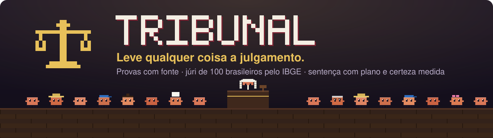
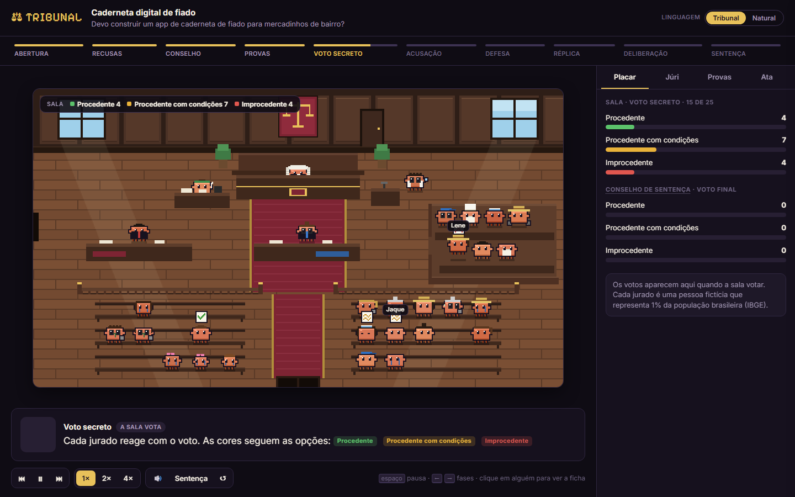
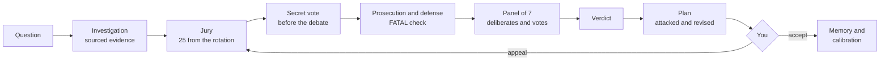
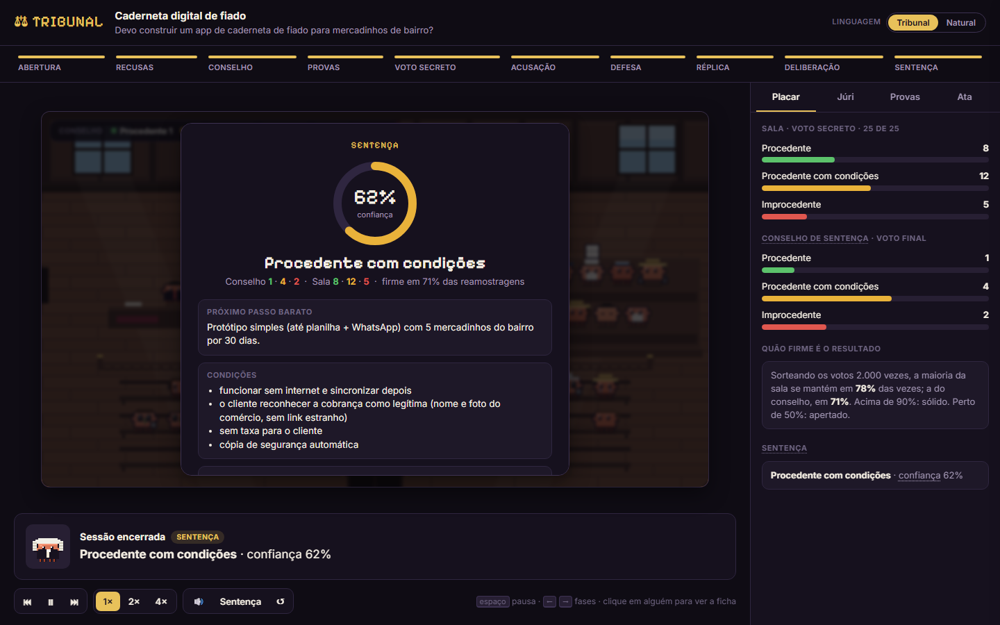
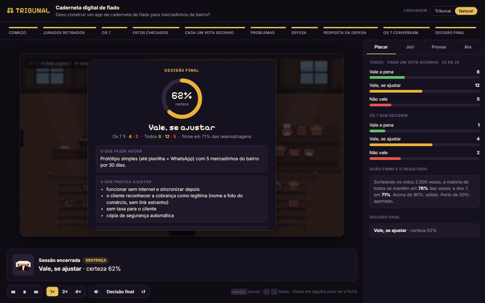

<p align="center">
  <a href="README.md">Português</a> · <strong>English</strong> · <a href="README.es.md">Español</a>
</p>

<p align="center">
  
  
  
  
  
  
</p>

<h3 align="center">Before you bet time and money on an idea, put it on trial.</h3>

**Tribunal** is a [Claude Code](https://claude.com/claude-code) skill that replaces an assistant's opinion with a
**process**. An expert gathers sourced evidence. A prosecutor attacks. A defense responds. A jury of **100
Brazilians calibrated to IBGE data** (Brazil's national statistics bureau) votes in secret. A judge delivers a
verdict with an **action plan, a point at which to quit, and a measured level of certainty**. You have the final word.

Use it for a business idea, a live app, a pull request, a product decision or a document.

<p align="center">
  
  <br/><sub>The courtroom opens in your browser and follows the trial live. <a href="https://tiagocardosobezerra.github.io/tribunal/"><strong>See the demo</strong></a></sub>
</p>

---

## In 30 seconds

> **You:** put my tab-tracking app for corner stores on trial.

Tribunal researches and logs the evidence, summons 25 jurors from the rotation, collects the secret vote, opens the
debate, draws the 7 who decide and returns:

> **Worth doing, with changes · certainty 62%**
>
> **Start here:** a simple prototype (even a spreadsheet and WhatsApp) with 5 neighborhood stores for 30 days.
> **What would change the decision:** fewer than 3 of the 5 owners still using it after 30 days.
> **When to quit:** if no owner agrees to pay R$ 20 a month within 60 days.
> **What people said:** *"If I get a payment reminder, how do I know it's really from the store?"* (former truck driver, 59)

You also get the full record, the scoreboard by type of person, and the pixel art courtroom closing with three
strikes of the gavel.

## Why a trial

Ask an AI for its opinion and you usually get one of two things: **flattery** ("great idea!") or **a single voice**
pretending to be many. A hundred copies of the same model with different names think almost alike, and a majority
vote only amplifies the bias they all share.

Tribunal gives each role the job it does best and makes every role justify itself:

| Role | What it does | The rule it cannot break |
|---|---|---|
| **Expert** | researches, **opens the real app**, runs the code | evidence without a source is only a claim |
| **Prosecutor** | attacks: pre-mortem, inversion, risks | every attack has a severity and a verifiable counterexample |
| **Verifier** | rechecks every FATAL attack | a label, a rounding or a wording issue is not fatal |
| **Defense** | defends and answers each attack | a rebuttal that only insists leaves the attack standing |
| **Jury** | reacts like real people | 25 vote in secret **before** the debate; 7 decide; **3 different models** |
| **Plan writer** | turns the verdict into steps | the plan is attacked and revised before it reaches you |
| **Judge** | rules | an independent subagent that only reads the case file and did not do the expert investigation; an open FATAL blocks a full verdict |
| **You** | final authority | accept, or appeal to a new jury |

## How it works



An open question ("how do I solve X?") first becomes a **proposal contest**. Three solutions, each written with a
different strategy, take a beating from the prosecution. The finalists go to the jury alongside "leave it as is".

## The jury: 100 Brazilians who are Brazil

Each of the 100 fictional jurors stands for **1% of the population**, using quotas from **IBGE's 2022 Census and
2025 PNAD household survey**: age from 1 to 100, region, race, education, income, work, religion, internet use and
disability. The cast's largest gap against IBGE is **0.6 percentage points**.

They are ordinary people, each with a story, values, fears, a bias and a way of talking: the woman who sells
homemade popsicles and drops anything with a fee, the former truck driver who smells a scam everywhere, the retired
engineer who wants backups, and Mãe Toinha, 100, who has never used a cell phone.

- **Unbiased rotation:** no one serves twice until everyone has served, and profiles that are too similar never
  land together.
- **Brazilian jury procedure:** 25 summoned, up to 3 strikes per side, 7 on the sentencing panel (articles 447 and
  468 of the CPP, Brazil's Code of Criminal Procedure).
- **Three models on the jury:** each batch runs on a different model (Sonnet, Haiku and Opus). Copies of the same
  model think alike; the score shows whether the models agree, and confidence drops when they do not.
- **A real appeal:** jurors from the original case stay off the new jury.

## What you get

| | |
|---|---|
| **Decision and certainty** | the verdict and how far to trust it, with the gaps holding certainty down and what would raise it |
| **Plan** | ordered steps, targets per group, tests with the expected result, and the cheapest step, with cost and time |
| **When to quit** | two or more triggers, each with a number and a deadline |
| **What would change the decision** | 3 to 5 scenarios, including the one that leads to not going ahead |
| **Problems found** | each with severity, fix and what the double check concluded |
| **Scoreboard by profile** | "everyone over 60 voted against because of the sign-up": worth more than the overall score |
| **Record and case file** | the whole process, in Markdown and JSON |
| **The courtroom** | the trial animated in your browser, live, with the sound of the gavel |

<p align="center">
  
  
  <br/><sub>Two languages, one trial: <strong>Tribunal</strong> uses court terms (verdict, panel, rebuttal) and <strong>Natural</strong> uses everyday words (result, the 7 who decide, the defense's answer).</sub>
</p>

## Measured results

Numbers from real trials, not demos.

**Cost.** Each role runs in a lean agent that only reads and writes files.

| | Full agent | Tribunal lean agent |
|---|---|---|
| Batch of 5 jurors | ~66k tokens | **~11k** |
| Prosecutor, defense or rebuttal | ~80k | **~13k** |
| Full trial | ~650k (version 1.0) | **~150k to 260k** |

**Validity: what the jury measures, and what it does not.** We measured it two ways, and the second contradicted the first.

| | Pilot (12 famous cases) | Blind test (30 cases) |
|---|---|---|
| Who wrote the descriptions | me, knowing the outcome | a separate agent, with rules against giving clues |
| Correct | 8 of 9 | **18 of 30** (p = 0.18: indistinguishable from chance) |
| Brier score (0 is perfect; a coin flip = 0.25) | 0.141 | **0.227** |
| Votes that recognized the product | 5% | 8% |

The jury **does not predict whether a product will succeed in the market** any better than chance. The pilot was
inflated by how the descriptions were written and by how famous the cases were. What the jury does is show **how
ordinary people react** to an idea, group by group, and that is not the same thing. Tribunal's value is in the
process: sourced evidence, checked attacks, an independent judge and a plan with a point at which to quit that tests
the idea in the real world. Details and a kit to repeat it: [`validacao/cegos/`](validacao/cegos/resultado-2026-11-09.md).

**Real end-to-end cost.** In a full real case (ritual 4), the subagents spent 279 thousand tokens, about US$ 1. The
orchestration in the main conversation weighs more and grows with the length of the conversation: from US$ 0.60 in a
fresh session to US$ 4 in a long one ([measurement](validacao/custo-caso-real-2026-11-09.md)).

**Consistency.** The same case, tried five times, got **the same verdict all five times**, including once with an
entirely new jury. Between two rounds, 84% of jurors repeated their own vote.

**Against a 16-agent tournament.** On the same question about a real SaaS, we compared Tribunal's verdict with the
winning answer of a 16-agent knockout tournament. Blind judges scored both using the tournament's own rubric:

| | Tribunal | 16-agent tournament |
|---|---|---|
| Tokens | **~260k** | ~6.8 million (stopped at the semifinal) |
| Score (average of 2 blind judges) | 71 | 83.5 |
| Factual accuracy (0 to 10) | 7 | 8 |
| Public reaction, scoreboard by profile, measured certainty | **yes** | no |

The tournament writes a longer, more detailed plan. Tribunal reaches **85% of the score at 4% of the cost** and
brings what a tournament does not: how real people would react and how far to trust the result. That head-to-head
led to version 1.3. For ~12k tokens, the double check corrected an overstated fatal attack that the tournament had
also raised.

**Engineering.** 50 automated tests, pure Python with no dependencies, and the case file validated at every phase.

## Installation

You need [Claude Code](https://claude.com/claude-code) and Python 3.8 or newer. Nothing to install with pip.

**1. Download the skill**

```bash
git clone https://github.com/tiagocardosobezerra/tribunal.git ~/.claude/skills/tribunal
```

```powershell
git clone https://github.com/tiagocardosobezerra/tribunal.git $HOME\.claude\skills\tribunal
```

**2. Install the lean agents** (they are what make a trial ~6 times cheaper)

```bash
cp ~/.claude/skills/tribunal/agentes/*.md ~/.claude/agents/
```

```powershell
Copy-Item $HOME\.claude\skills\tribunal\agentes\*.md $HOME\.claude\agents\
```

**3. Ask for a trial** (in a new Claude Code session)

> put my idea for ... on trial
> tribunal: can this PR go to production?
> what would people think of this app? https://...
> should I do X or Y?

The first time, Tribunal asks whether you prefer court terms or natural language.

## Modes and cost

| Mode | When to use | Subagents | Tokens |
|---|---|---|---|
| **Full** | decisions that matter | 9 to 18 | ~150k to 260k |
| **Quick** | small, reversible decisions | 0 | the conversation only |

`python tribunal.py plano --modo completo` shows the cost before you start. If the vote of the 25 comes out close,
Tribunal calls in **reinforcements** of 25 more jurors. If it comes out lopsided early, it skips the remaining batches.

## Memory and calibration

Each case can go to your **Memory Card**, a private repository on your GitHub, but only after you say "yes". Saved
cases become **case law** for future trials. When you report how a decision turned out, Tribunal measures whether
its certainty matched reality.

## Privacy

- The jurors are **fictional**. The case file stores no passwords, tokens, CPF (Brazilian tax ID) or real personal
  data.
- Nothing leaves your computer unless you ask: the Memory Card shows a preview and only writes after you confirm.
- The expert does not create accounts on production sites. Whatever cannot be verified becomes a **gap**, stated in
  the verdict.

<details>
<summary><strong>All commands</strong></summary>

```bash
python tribunal.py status                          # foro, rodízio, Memory Card
python tribunal.py novo "Título" --tipo ideia      # abre um caso
python tribunal.py proximo <autos>                 # a próxima fase e o comando exato
python tribunal.py plano --modo completo           # quantos subagentes e tokens
python tribunal.py onda <autos> [--juntar]         # a fase atual: briefings e chamadas prontas; --juntar junta tudo
python tribunal.py validacao preparar --pasta P     # júri contra casos de desfecho conhecido; depois: resultado
python tribunal.py juri convocar --autos <autos>   # os 25 do rodízio, gravados nos autos
python tribunal.py juri conselho <sessão> --acusacao IDS --defesa IDS --autos <autos>
python tribunal.py briefing <autos> --rodada 1 --lote 1 --de 5
python tribunal.py juntar <autos>                  # junta os votos
python tribunal.py parar <autos>                   # parada antecipada
python tribunal.py reforco <autos>                 # reforço do júri
python tribunal.py debate <autos> --papel promotor # e defesa, replica, checagem, plano, plano_ataque, plano_revisao
python tribunal.py juntar-debate <autos>
python tribunal.py placar <autos>
python tribunal.py validar <autos>
python tribunal.py entrega <autos> [--enxuta]      # a resposta final, montada dos autos
python tribunal.py ata <autos> -o ata.md [--linguagem natural]
python tribunal.py visualizar <autos> --abrir      # a sala; ?fase=N, ?linguagem=natural, ?som=0
python tribunal.py comparar <autos_a> <autos_b>    # dois julgamentos do mesmo caso
python tribunal.py linguagem natural               # ou tribunal
python tribunal.py cartao enviar <autos>           # prévia; --confirmar grava no Memory Card
```

Tests: `python -m unittest discover -s testes`.

</details>

## Honest limits

- **The verdict is not a prediction of success.** In the blind test, the jury got the outcome right for 18 of 30
  products, close to chance. Read the scoreboard as public reaction, and the verdict as a plan to test, never as a
  guarantee.
- The jury is lay: for B2B or technical products, its reaction weighs little, and the expert and the witnesses weigh
  more.
- The jurors are **simulations** produced by language models from calibrated profiles. They widen your
  perspective. They do not replace talking to real people, which is what the verdict's next step is for.
- The IBGE quotas match one by one. The crossings (income by region, for example) are plausible, not exact.
- With 100 seats, groups smaller than 0.5% of the population get no juror. To hear them, the judge calls witnesses.
- Tribunal does not give investment advice and does not replace a doctor, lawyer or accountant.

Jury sources and choices: [`referencias/populacao-brasil.md`](referencias/populacao-brasil.md) ·
Version history: [`CHANGELOG.md`](CHANGELOG.md)

## Next steps

- Venues for other countries, using the same quota method.
- Automatic certainty calibration from recorded outcomes.
- App investigation with browsing guided by the jury's profiles.

## Author

Made by **[Tiago Cardoso Bezerra](https://github.com/tiagocardosobezerra)**, who also created
[Vegapunk](https://github.com/tiagocardosobezerra/vegapunk) (T-SQL with your database's real names),
[Senku](https://github.com/tiagocardosobezerra/senku) (process mapping in BPMN) and
[Deidara](https://github.com/tiagocardosobezerra/deidara) (from data to Power BI dashboard).

MIT license. The jurors are fictional; any resemblance to real people is coincidental.
