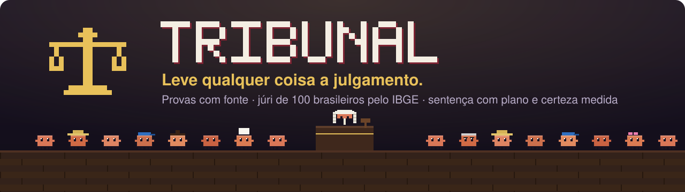
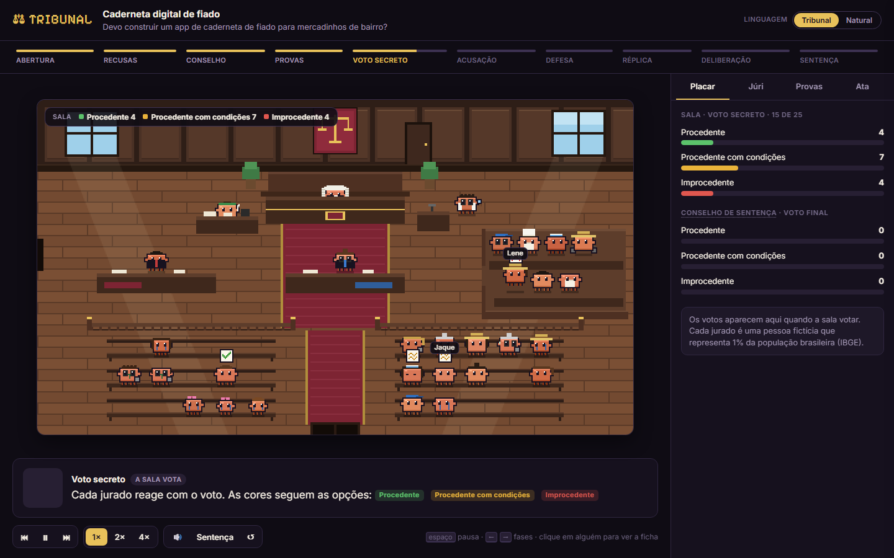
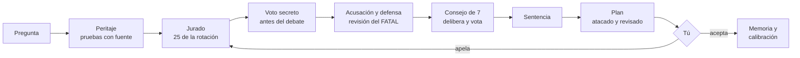
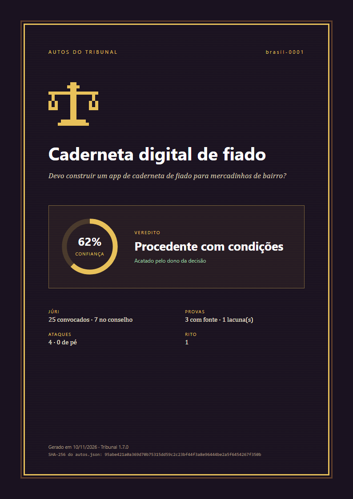
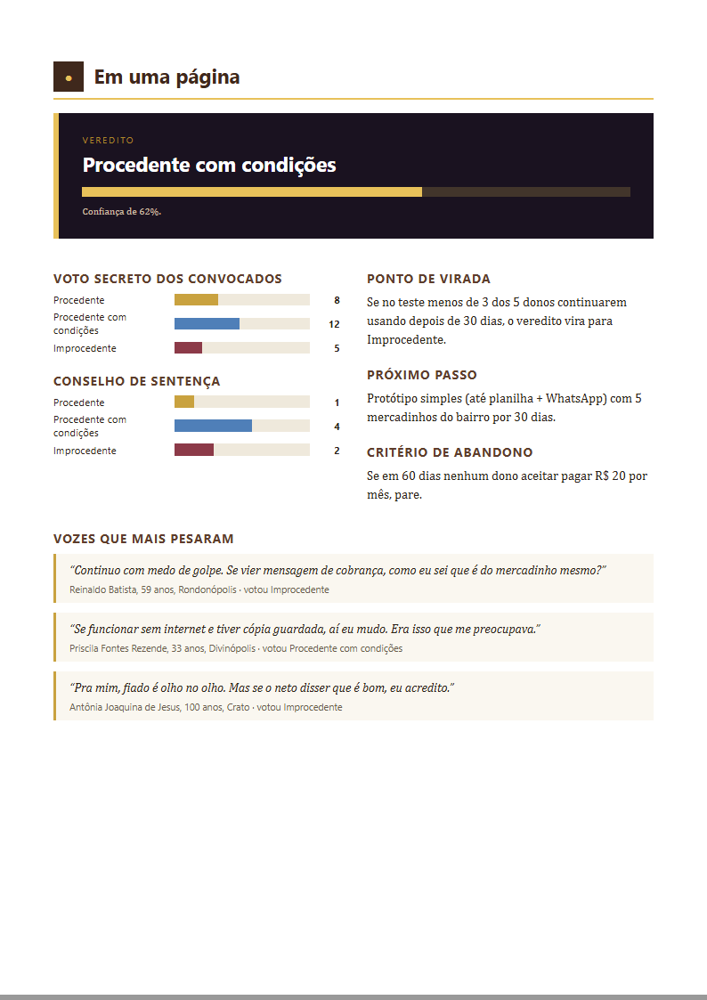
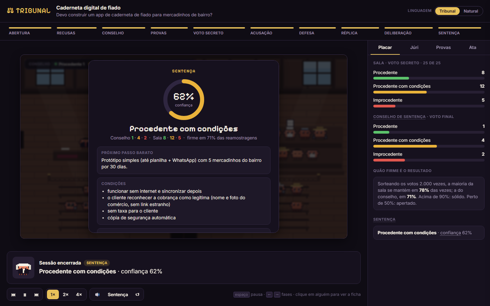
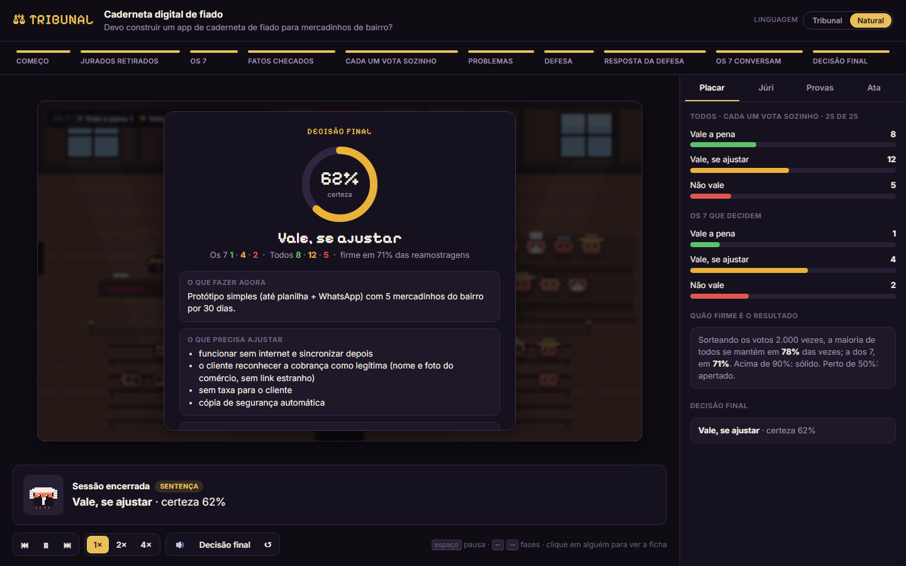

<p align="center">
  <a href="README.md">Português</a> · <a href="README.en.md">English</a> · <strong>Español</strong>
</p>

<p align="center">
  
  
  
  
  
  
</p>

<h3 align="center">Antes de apostar tiempo y dinero en una idea, llévala a juicio.</h3>

**Tribunal** es una skill de [Claude Code](https://claude.com/claude-code) que cambia la opinión de un asistente por
un **proceso**: un perito reúne pruebas con fuente, un fiscal acusa, una defensa responde, un jurado de **100
brasileños calibrados con datos del IBGE** (el instituto nacional de estadística de Brasil) vota en secreto y un juez
dicta una sentencia con **plan de acción, criterio para abandonar y certeza medida**. La última palabra es tuya.

Sirve para una idea de negocio, una app en producción, un pull request, una decisión de producto o un documento.

<p align="center">
  
  <br/><sub>La sala se abre en el navegador y sigue el juicio en vivo. <a href="https://tiagocardosobezerra.github.io/tribunal/"><strong>Ver la demostración</strong></a></sub>
</p>

---

## En 30 segundos

> **Tú:** lleva a juicio mi app para anotar el fiado en las tiendas de barrio.

Tribunal investiga y registra las pruebas, convoca a 25 jurados de la rotación, recoge el voto secreto, abre el
debate, sortea a los 7 que deciden y te entrega:

> **Vale la pena, con ajustes · certeza 62%**
>
> **Empieza por aquí:** un prototipo simple (hasta con una hoja de cálculo y WhatsApp) con 5 tiendas del barrio durante 30 días.
> **Qué cambiaría la decisión:** que menos de 3 de los 5 dueños la sigan usando después de 30 días.
> **Cuándo abandonar:** si en 60 días ningún dueño acepta pagar R$ 20 al mes.
> **Qué dijo la gente:** *"Si me llega un mensaje de cobro, ¿cómo sé que de verdad es de la tienda?"* (excamionero, 59 años)

Con el acta completa, el marcador por perfil de persona y la sala en pixel art, que cierra con tres golpes de mazo.

## Por qué un tribunal

Pedirle su opinión a una IA suele terminar en dos cosas: **adulación** ("¡excelente idea!") o **una sola voz**
que finge ser muchas. Cien copias del mismo modelo con nombres distintos piensan casi igual, y el voto de la mayoría
solo amplifica el sesgo que todas comparten.

Tribunal le da a cada papel lo que mejor hace y obliga a cada uno a justificarse:

| Papel | Qué hace | La regla que no puede romper |
|---|---|---|
| **Perito** | investiga, **abre la app de verdad**, ejecuta el código | una prueba sin fuente es solo una afirmación |
| **Fiscal** | acusa: pre-mortem, inversión, riesgos | cada ataque tiene gravedad y un contraejemplo verificable |
| **Verificador** | revisa de nuevo cada ataque FATAL | una etiqueta, un redondeo o un texto no son fatales |
| **Defensa** | defiende y responde a cada ataque | rebatir solo insistiendo deja el ataque en pie |
| **Jurado** | reacciona como gente de verdad | 25 votan en secreto **antes** del debate; 7 deciden; **3 modelos distintos** |
| **Redactor del plan** | convierte la sentencia en pasos | el plan se ataca y se revisa antes de llegar a ti |
| **Juez** | sentencia | un subagente independiente, que solo lee el expediente y no hizo el peritaje; un FATAL pendiente bloquea el veredicto pleno |
| **Tú** | última instancia | aceptas o apelas ante un jurado nuevo |

## Cómo funciona



Una pregunta abierta ("¿cómo resuelvo X?") primero se convierte en un **concurso de propuestas**: tres soluciones
escritas con estrategias distintas reciben los golpes de la acusación, y las finalistas llegan al jurado junto a la
opción de "dejarlo como está".

## El jurado: 100 brasileños que son Brasil

Cada uno de los 100 jurados ficticios representa el **1% de la población**, con las cuotas del **Censo 2022 y la
PNAD 2025 (la encuesta nacional de hogares) del IBGE**: edad de 1 a 100 años, región, color o raza, escolaridad,
ingreso, trabajo, religión, uso de internet y discapacidad. La mayor desviación del elenco frente al IBGE es de
**0,6 puntos porcentuales**.

Son personas comunes, cada una con su historia, valores, miedos, un sesgo y su manera de hablar: la vendedora de
helados caseros que abandona cualquier cosa que cobre comisión, el excamionero que ve estafas en todo, la ingeniera
jubilada que pregunta por las copias de seguridad, la Mãe Toinha, de 100 años, que nunca usó un celular.

- **Rotación sin sesgo:** nadie repite antes de que todos hayan servido, y los perfiles demasiado parecidos nunca
  caen juntos.
- **El rito del jurado brasileño:** 25 convocados, hasta 3 recusaciones por lado, 7 en el Consejo de Sentencia
  (Código de Proceso Penal de Brasil, CPP, arts. 447 y 468).
- **Tres modelos en el jurado:** cada lote corre en un modelo distinto (Sonnet, Haiku y Opus). Las copias del mismo
  modelo piensan parecido; el marcador muestra si los modelos coinciden, y la confianza baja cuando no.
- **Apelación de verdad:** quien juzgó el caso original queda fuera del jurado nuevo.

## Qué recibes

| | |
|---|---|
| **Decisión y certeza** | el veredicto y cuánto confiar en él, con los vacíos que frenan la certeza y lo que la haría subir |
| **Plan** | pasos en orden, metas por grupo, pruebas con el resultado esperado y el paso más barato, con costo y tiempo |
| **Cuándo abandonar** | dos o más señales de salida, cada una con un número y un plazo |
| **Qué cambiaría la decisión** | de 3 a 5 escenarios, incluido el que lleva a no seguir |
| **Problemas encontrados** | cada uno con gravedad, corrección y lo que concluyó la doble revisión |
| **Marcador por perfil** | "todos los mayores de 60 votaron en contra por el registro": vale más que el marcador general |
| **Acta y expediente** | el proceso completo, en Markdown y JSON |
| **La sala** | el juicio animado en el navegador, en vivo, con el sonido del mazo |
| **Dossier en PDF** | portada, resumen de una página, pruebas con fuente, ataques, jurado, sentencia y plan, con el SHA-256 del expediente: para llevar a la discusión |

<p align="center">
  
  
  <br/><sub>El dossier en PDF (<code>tribunal.py exportar</code>): la portada y el resumen de una página.</sub>
</p>

<p align="center">
  
  
  <br/><sub>Dos lenguajes, el mismo juicio: <strong>Tribunal</strong>, con términos de juzgado (veredicto, consejo, réplica), o <strong>Natural</strong>, con palabras de todos los días (resultado, los 7 que deciden, respuesta de la defensa).</sub>
</p>

## Resultados medidos

Números de juicios reales, no de demostración.

**Costo.** Cada papel corre en un agente ligero, que solo lee y escribe archivos.

| | Agente completo | Agente ligero de Tribunal |
|---|---|---|
| Lote de 5 jurados | ~66 mil tokens | **~11 mil** |
| Fiscal, defensa o réplica | ~80 mil | **~13 mil** |
| Juicio completo | ~650 mil (versión 1.0) | **~150 a 260 mil** |

**Validez: lo que mide el jurado, y lo que no mide.** Lo medimos de dos formas, y la segunda desmintió a la primera.

| | Piloto (12 casos famosos) | Prueba ciega (30 casos) |
|---|---|---|
| Quién escribió las descripciones | yo, conociendo el desenlace | un agente aparte, con reglas contra las pistas |
| Aciertos | 8 de 9 | **18 de 30** (p = 0,18: no se distingue del azar) |
| Brier (0 es perfecto; tirar una moneda = 0,25) | 0,141 | **0,227** |
| Votos que reconocieron el producto | 5% | 8% |

El jurado **no predice si un producto va a funcionar en el mercado** mejor que el azar. El piloto estaba inflado por
la redacción de las descripciones y por la fama de los casos. Lo que hace el jurado es mostrar **cómo reaccionan las
personas comunes** ante una idea, grupo por grupo, y eso no es lo mismo. El valor de Tribunal está en el proceso:
pruebas con fuente, ataques revisados, un juez independiente y un plan con criterio para abandonar que pone a prueba
la idea en el mundo real. Detalles y kit para repetirlo: [`validacao/cegos/`](validacao/cegos/resultado-2026-11-09.md).

**Costo real de punta a punta.** En un caso real completo (rito 4), los subagentes gastaron 279 mil tokens, unos
US$ 1. La orquestación en la conversación principal pesa más y crece con el largo de la conversación: de US$ 0,60 en
una sesión nueva a US$ 4 en una sesión larga ([medición](validacao/custo-caso-real-2026-11-09.md)).

**Consistencia.** El mismo caso, juzgado cinco veces, dio **el mismo veredicto en las cinco**, incluso con un jurado
totalmente nuevo. Entre dos rondas, el 84% de los jurados repitió su voto.

**Contra un torneo de 16 agentes.** Con la misma pregunta sobre un SaaS real, comparamos la sentencia de Tribunal con
la respuesta ganadora de un torneo eliminatorio de 16 agentes, con jueces ciegos y la rúbrica del propio torneo:

| | Tribunal | Torneo de 16 agentes |
|---|---|---|
| Tokens | **~260 mil** | ~6,8 millones (detenido en la semifinal) |
| Nota (promedio de 2 jueces ciegos) | 71 | 83,5 |
| Exactitud de los hechos (0 a 10) | 7 | 8 |
| Reacción del público, marcador por perfil, certeza medida | **sí** | no |

El torneo escribe un plan más largo y detallado; Tribunal llega al **85% de la nota con el 4% del costo** y aporta lo
que un torneo no da: cómo reaccionarían personas reales y cuánto confiar en el resultado. De ese duelo salió la
versión 1.3: la doble revisión corrigió, por ~12 mil tokens, un ataque fatal exagerado que el torneo también había
señalado.

**Ingeniería.** 52 pruebas automáticas, Python puro sin dependencias, expediente validado en cada fase.

## Instalación

Necesitas [Claude Code](https://claude.com/claude-code) y Python 3.8 o más reciente. Nada que instalar con pip.

**1. Descarga la skill**

```bash
git clone https://github.com/tiagocardosobezerra/tribunal.git ~/.claude/skills/tribunal
```

```powershell
git clone https://github.com/tiagocardosobezerra/tribunal.git $HOME\.claude\skills\tribunal
```

**2. Instala los agentes ligeros** (son los que hacen el juicio ~6 veces más barato)

```bash
cp ~/.claude/skills/tribunal/agentes/*.md ~/.claude/agents/
```

```powershell
Copy-Item $HOME\.claude\skills\tribunal\agentes\*.md $HOME\.claude\agents\
```

**Opcional: un jurado de otra familia de modelos.** Las copias de Claude piensan parecido. Con un modelo de fuera,
el lote 2 del jurado corre en él, por cualquier API compatible con la de OpenAI. El briefing del caso va a ese
proveedor.

```bash
export TRIBUNAL_EXTERNO_MODELO=openai/gpt-5-mini      # en OpenRouter, con OPENROUTER_API_KEY definida
# o, gratis y sin salir de tu máquina:
export TRIBUNAL_EXTERNO_MODELO=qwen3:8b TRIBUNAL_EXTERNO_URL=http://localhost:11434/v1   # Ollama
```

**3. Pide un juicio** (en una sesión nueva de Claude Code)

> lleva a juicio mi idea de ...
> tribunal: ¿este PR puede ir a producción?
> ¿qué pensaría la gente de esta app? https://...
> ¿debo hacer X o Y?

La primera vez, Tribunal te pregunta si prefieres términos de tribunal o lenguaje natural.

## Modos y costo

| Modo | Cuándo usarlo | Subagentes | Tokens |
|---|---|---|---|
| **Completo** | decisiones que importan | 9 a 18 | ~150 a 260 mil |
| **Rápido** | decisiones pequeñas y reversibles | 0 | solo la conversación |

`python tribunal.py plano --modo completo` muestra el costo antes de empezar. Si el marcador de los 25 sale ajustado,
Tribunal llama a un **refuerzo** de 25 jurados más; si sale holgado temprano, descarta los lotes restantes.

## Memoria y calibración

Cada caso puede ir a tu **Memory Card**, un repositorio privado en tu GitHub, solo después de tu "sí". Los casos
guardados se vuelven **jurisprudencia** para los siguientes, y cuando cuentas cómo terminó la decisión, Tribunal mide
si su certeza coincidió con la realidad.

## Privacidad

- Los jurados son **ficticios**. El expediente no guarda contraseñas, tokens, CPF (el identificador fiscal de Brasil)
  ni datos personales reales.
- Nada sale de tu computadora sin que lo pidas: el Memory Card muestra una vista previa y solo guarda con tu
  confirmación.
- El perito no crea cuentas en sitios en producción. Lo que no se puede verificar queda como **vacío**, declarado en
  la sentencia.

<details>
<summary><strong>Todos los comandos</strong></summary>

```bash
python tribunal.py status                          # foro, rodízio, Memory Card
python tribunal.py novo "Título" --tipo ideia      # abre um caso
python tribunal.py proximo <autos>                 # a próxima fase e o comando exato
python tribunal.py plano --modo completo           # quantos subagentes e tokens
python tribunal.py onda <autos> [--juntar]         # a fase atual: briefings e chamadas prontas; --juntar junta tudo
python tribunal.py externo <briefing> <destino>    # um lote num modelo de outra família (opcional)
python tribunal.py validacao preparar --pasta P     # júri contra casos de desfecho conhecido; depois: resultado
python tribunal.py juri convocar --autos <autos>   # os 25 do rodízio, gravados nos autos
python tribunal.py juri conselho <sessão> --acusacao IDS --defesa IDS --autos <autos>
python tribunal.py briefing <autos> --rodada 1 --lote 1 --de 5
python tribunal.py juntar <autos>                  # junta os votos
python tribunal.py parar <autos>                   # parada antecipada
python tribunal.py reforco <autos>                 # reforço do júri
python tribunal.py debate <autos> --papel promotor # e defesa, replica, checagem, plano, plano_ataque, plano_revisao
python tribunal.py juntar-debate <autos>
python tribunal.py placar <autos>
python tribunal.py validar <autos>
python tribunal.py entrega <autos> [--enxuta]      # a resposta final, montada dos autos
python tribunal.py ata <autos> -o ata.md [--linguagem natural]
python tribunal.py exportar <autos> [-o arq.pdf]      # el dossier del juicio en PDF, para mostrar a otras personas
python tribunal.py visualizar <autos> --abrir      # a sala; ?fase=N, ?linguagem=natural, ?som=0
python tribunal.py comparar <autos_a> <autos_b>    # dois julgamentos do mesmo caso
python tribunal.py linguagem natural               # ou tribunal
python tribunal.py cartao enviar <autos>           # prévia; --confirmar grava no Memory Card
```

Pruebas: `python -m unittest discover -s testes`.

</details>

## Límites honestos

- **El veredicto no es una predicción de éxito.** En la prueba ciega, el jurado acertó el desenlace de 18 de 30
  productos, cerca del azar. Lee el marcador como reacción del público, y la sentencia como un plan para probar,
  nunca como una garantía.
- El jurado es lego: para productos B2B o técnicos, su reacción pesa poco, y el perito y los testigos pesan más.
- Los jurados son **simulaciones** que hacen modelos de lenguaje a partir de fichas calibradas. Amplían la
  perspectiva; no reemplazan hablar con personas reales. Para eso existe el próximo paso de la sentencia.
- Las cuotas del IBGE coinciden una por una; los cruces (ingreso por región, por ejemplo) son plausibles, no exactos.
- Con 100 lugares, los grupos menores al 0,5% de la población quedan sin jurado. Para escucharlos, el juez llama a
  testigos.
- Tribunal no da consejos de inversión y no reemplaza a un médico, abogado ni contador.

Fuentes y decisiones del jurado: [`referencias/populacao-brasil.md`](referencias/populacao-brasil.md) ·
Historial de versiones: [`CHANGELOG.md`](CHANGELOG.md)

## Próximos pasos

- Foros de otros países, con el mismo método de cuotas.
- Calibración automática de la certeza a partir de los desenlaces registrados.
- Peritaje de apps con navegación guiada por los perfiles del jurado.

## Autor

Hecho por **[Tiago Cardoso Bezerra](https://github.com/tiagocardosobezerra)**, que también creó
[Vegapunk](https://github.com/tiagocardosobezerra/vegapunk) (T-SQL con los nombres reales de tu base de datos),
[Senku](https://github.com/tiagocardosobezerra/senku) (mapeo de procesos en BPMN) y
[Deidara](https://github.com/tiagocardosobezerra/deidara) (de los datos al tablero de Power BI).

Licencia MIT. Los jurados son ficticios; cualquier parecido con personas reales es coincidencia.
