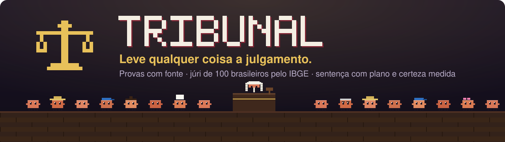
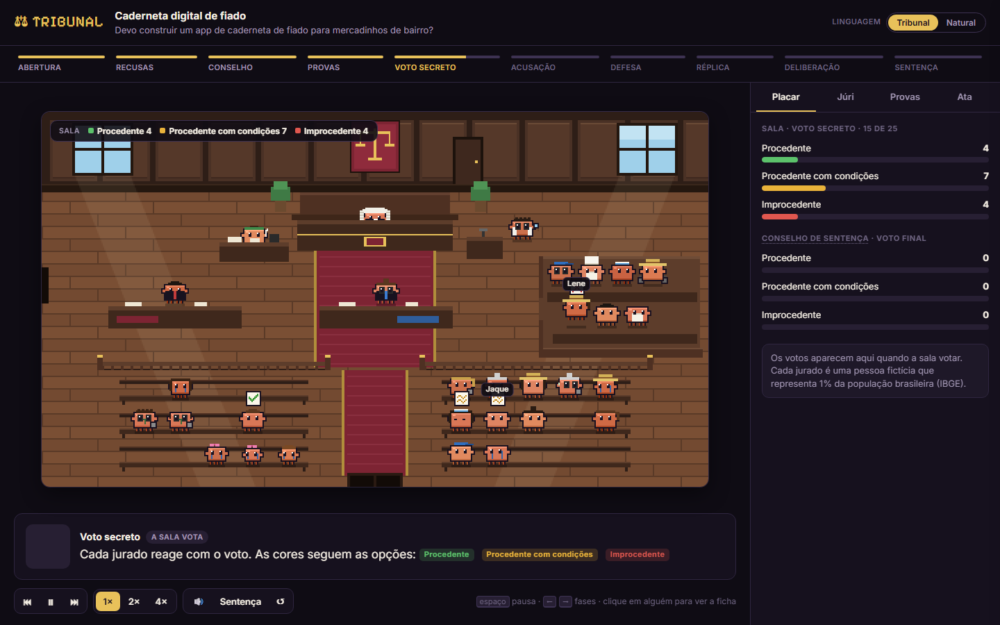
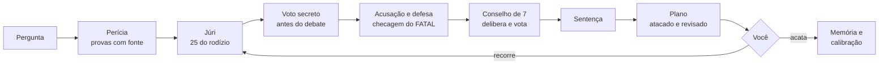
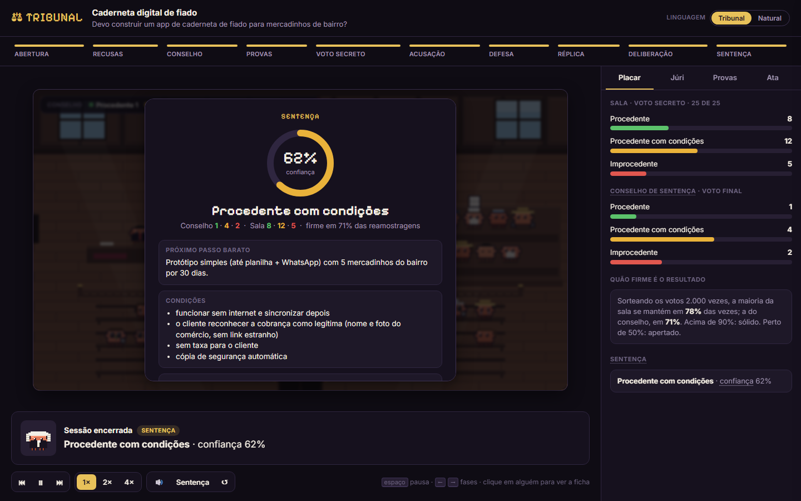
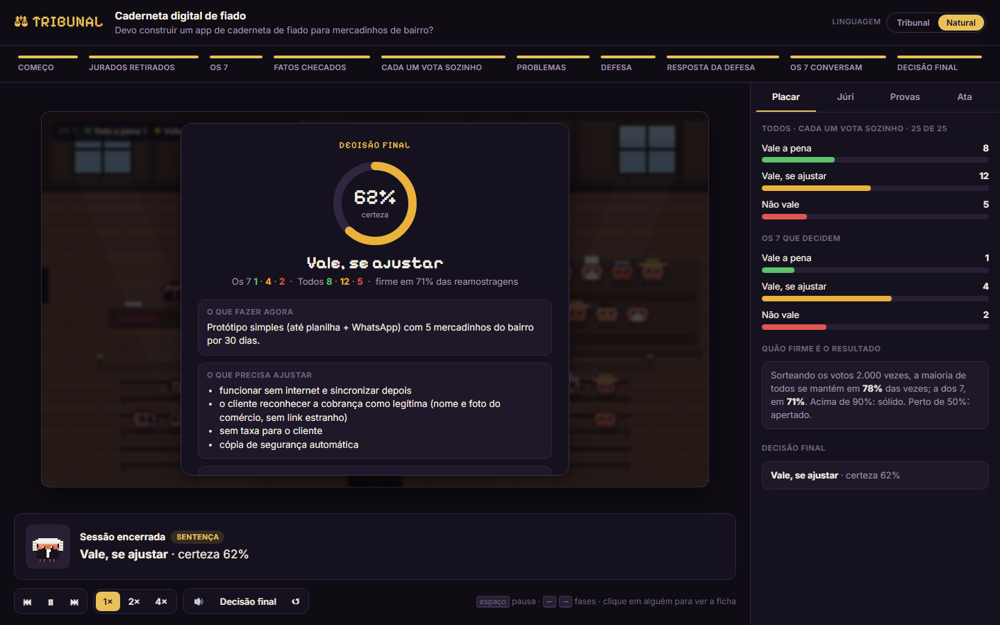

<p align="center">
  <strong>Português</strong> · <a href="README.en.md">English</a> · <a href="README.es.md">Español</a>
</p>

<p align="center">
  
  
  
  
  
  
</p>

<h3 align="center">Antes de apostar tempo e dinheiro numa ideia, leve-a a julgamento.</h3>

O **Tribunal** é uma skill do [Claude Code](https://claude.com/claude-code) que troca a opinião de um assistente por
um **processo**: um perito levanta provas com fonte, um promotor ataca, uma defesa responde, um júri de **100
brasileiros calibrados pelo IBGE** vota em segredo e um juiz entrega uma sentença com **plano de ação, critério de
desistência e certeza medida**. A última palavra é sua.

Serve para uma ideia de negócio, um app no ar, um pull request, uma decisão de produto ou um documento.

<p align="center">
  
  <br/><sub>A sala abre no navegador e acompanha o julgamento ao vivo. <a href="https://tiagocardosobezerra.github.io/tribunal/"><strong>Ver a demonstração</strong></a></sub>
</p>

---

## Em 30 segundos

> **Você:** leva a julgamento o meu app de caderneta de fiado para mercadinhos de bairro.

O Tribunal pesquisa e anota as provas, convoca 25 jurados do rodízio, colhe o voto secreto, abre o debate, sorteia
os 7 que decidem e devolve:

> **Vale, se ajustar · certeza 62%**
>
> **Comece por aqui:** protótipo simples (até planilha e WhatsApp) com 5 mercadinhos do bairro por 30 dias.
> **O que mudaria a decisão:** menos de 3 dos 5 donos ainda usando depois de 30 dias.
> **Quando desistir:** se em 60 dias nenhum dono aceitar pagar R$ 20 por mês.
> **O que as pessoas disseram:** *"Se vier mensagem de cobrança, como eu sei que é do mercadinho mesmo?"* (ex-caminhoneiro, 59 anos)

Com a ata completa, o placar por perfil de pessoa e a sala em pixel art terminando com três batidas do malhete.

## Por que um tribunal

Pedir a opinião de uma IA costuma dar em duas coisas: **bajulação** ("ótima ideia!") ou **uma voz só** fingindo
ser muitas. Cem cópias do mesmo modelo com nomes diferentes pensam quase igual, e o voto da maioria só amplifica o
viés que todas compartilham.

O Tribunal separa o que cada papel faz melhor e obriga cada um a se justificar:

| Papel | O que faz | A regra que não pode quebrar |
|---|---|---|
| **Perito** | pesquisa, **abre o app de verdade**, roda o código | prova sem fonte é só alegação |
| **Promotor** | ataca: pré-mortem, inversão, riscos | todo ataque tem gravidade e contraexemplo verificável |
| **Verificador** | reconfere todo ataque FATAL | rótulo, arredondamento ou texto não é fatal |
| **Defesa** | defende e responde a cada ataque | rebater só insistindo deixa o ataque de pé |
| **Júri** | reage como gente de verdade | 25 votam em segredo **antes** do debate; 7 decidem; **3 modelos diferentes** |
| **Redator do plano** | transforma a sentença em passos | o plano é atacado e revisado antes de chegar a você |
| **Juiz** | sentencia | um subagente independente, que só lê os autos e não fez a perícia; um FATAL pendente trava o veredito pleno |
| **Você** | instância final | acata, ou recorre a um júri novo |

## Como funciona



Uma pergunta aberta ("como resolvo X?") vira primeiro um **concurso de propostas**: três soluções escritas com
estratégias diferentes apanham da acusação, e as finalistas vão ao júri ao lado do "deixar como está".

## O júri: 100 brasileiros que são o Brasil

Cada um dos 100 jurados fictícios representa **1% da população**, com as cotas do **Censo 2022 e da PNAD 2025 do
IBGE**: idade de 1 a 100 anos, região, cor ou raça, escolaridade, renda, trabalho, religião, uso de internet e
deficiência. O maior desvio do elenco contra o IBGE é de **0,6 ponto percentual**.

São pessoas comuns, cada uma com história, valores, medos, um viés e um jeito de falar: a vendedora de geladinho
que desiste de qualquer taxa, o ex-caminhoneiro que vê golpe em tudo, a engenheira aposentada que quer backup, a
Mãe Toinha, de 100 anos, que nunca usou celular.

- **Rodízio sem viés:** ninguém repete antes de todos servirem, e perfis parecidos demais nunca caem juntos.
- **Rito do júri brasileiro:** 25 convocados, até 3 recusas por lado, 7 no Conselho de Sentença (CPP, arts. 447 e
  468).
- **Três modelos no júri:** cada lote roda num modelo diferente (Sonnet, Haiku e Opus). Cópias do mesmo modelo
  pensam parecido; o placar mostra se os modelos concordam e a confiança cai quando discordam.
- **Recurso de verdade:** quem julgou o caso de origem fica fora do júri novo.

## O que você recebe

| | |
|---|---|
| **Decisão e certeza** | o veredito e quanto confiar nele, com as lacunas que seguram a certeza e o que a faria subir |
| **Plano** | passos em ordem, metas por grupo, testes com o resultado esperado e o passo mais barato, com custo e tempo |
| **Quando desistir** | dois ou mais gatilhos, cada um com número e prazo |
| **O que mudaria a decisão** | de 3 a 5 cenários, inclusive o que leva a não seguir |
| **Problemas encontrados** | cada um com gravidade, correção e o que a checagem dupla concluiu |
| **Placar por perfil** | "todos acima de 60 anos votaram contra por causa do cadastro": vale mais que o placar geral |
| **Ata e autos** | o processo inteiro, em Markdown e JSON |
| **A sala** | o julgamento animado no navegador, ao vivo, com o som do malhete |

<p align="center">
  
  
  <br/><sub>Duas linguagens, o mesmo julgamento: <strong>Tribunal</strong> (veredito, conselho, réplica) ou <strong>Natural</strong> (resultado, os 7 que decidem, resposta da defesa).</sub>
</p>

## Resultados medidos

Números de julgamentos reais, não de demonstração.

**Custo.** Cada papel roda num agente enxuto, que só lê e grava arquivos.

| | Agente completo | Agente enxuto do Tribunal |
|---|---|---|
| Lote de 5 jurados | ~66 mil tokens | **~11 mil** |
| Promotor, defesa ou réplica | ~80 mil | **~13 mil** |
| Julgamento completo | ~650 mil (versão 1.0) | **~150 a 260 mil** |

**Validade: o que o júri mede, e o que não mede.** Medimos de duas formas, e a segunda desmentiu a primeira.

| | Piloto (12 casos famosos) | Teste cego (30 casos) |
|---|---|---|
| Quem escreveu as descrições | eu, sabendo o desfecho | um agente separado, com regras contra pistas |
| Acerto | 8 de 9 | **18 de 30** (p = 0,18: não se distingue do acaso) |
| Brier (0 é perfeito; chute = 0,25) | 0,141 | **0,227** |
| Votos que reconheceram o produto | 5% | 8% |

O júri **não prevê se um produto vai dar certo no mercado** melhor que o acaso. O piloto estava inflado pela
redação das descrições e pela fama dos casos. O que o júri faz é mostrar **como pessoas comuns reagem** a uma ideia,
grupo por grupo, e isso não é a mesma coisa. O valor do Tribunal está no processo: provas com fonte, ataques
checados, juiz independente e um plano com critério de abandono que testa a ideia no mundo real. Detalhes e kit
para repetir: [`validacao/cegos/`](validacao/cegos/resultado-2026-11-09.md).

**Custo real de ponta a ponta.** Num caso real completo (rito 4), os subagentes gastaram 279 mil tokens, cerca de
US$ 1. A orquestração na conversa principal pesa mais e cresce com o tamanho da conversa: de US$ 0,60, numa sessão
nova, a US$ 4, numa sessão longa ([medição](validacao/custo-caso-real-2026-11-09.md)).

**Consistência.** O mesmo caso, julgado cinco vezes, deu **o mesmo veredito nas cinco**, inclusive com um júri
inteiramente novo. Entre duas rodadas, 84% dos jurados repetiram o próprio voto.

**Contra um torneio de 16 agentes.** Na mesma pergunta sobre um SaaS real, comparamos a sentença do Tribunal com a
resposta campeã de um torneio eliminatório de 16 agentes, por juízes cegos e com a rubrica do próprio torneio:

| | Tribunal | Torneio de 16 agentes |
|---|---|---|
| Tokens | **~260 mil** | ~6,8 milhões (parado na semifinal) |
| Nota (média de 2 juízes cegos) | 71 | 83,5 |
| Correção dos fatos (0 a 10) | 7 | 8 |
| Reação do público, placar por perfil, certeza medida | **sim** | não |

O torneio escreve um plano mais longo e detalhado; o Tribunal chega a **85% da nota com 4% do custo** e traz o que
um torneio não traz: como pessoas reais reagiriam e o quanto confiar no resultado. Foi esse duelo que gerou a
versão 1.3: a checagem dupla corrigiu, por ~12 mil tokens, um ataque fatal exagerado que o torneio também tinha
apontado.

**Engenharia.** 50 testes automáticos, Python puro sem dependências, autos validados a cada fase.

## Instalação

Precisa do [Claude Code](https://claude.com/claude-code) e de Python 3.8 ou mais novo. Nada para instalar via pip.

**1. Baixe a skill**

```bash
git clone https://github.com/tiagocardosobezerra/tribunal.git ~/.claude/skills/tribunal
```

```powershell
git clone https://github.com/tiagocardosobezerra/tribunal.git $HOME\.claude\skills\tribunal
```

**2. Instale os agentes enxutos** (são eles que deixam o julgamento ~6 vezes mais barato)

```bash
cp ~/.claude/skills/tribunal/agentes/*.md ~/.claude/agents/
```

```powershell
Copy-Item $HOME\.claude\skills\tribunal\agentes\*.md $HOME\.claude\agents\
```

**3. Peça um julgamento** (numa sessão nova do Claude Code)

> leva a julgamento a minha ideia de ...
> tribunal: esse PR pode ir para produção?
> o que o povo acharia deste app? https://...
> devo fazer X ou Y?

Na primeira vez, o Tribunal pergunta se você prefere termos de tribunal ou linguagem natural.

## Modos e custo

| Modo | Quando usar | Subagentes | Tokens |
|---|---|---|---|
| **Completo** | decisões que importam | 9 a 18 | ~150 a 260 mil |
| **Rápido** | decisões pequenas e reversíveis | 0 | só a conversa |

`python tribunal.py plano --modo completo` mostra o custo antes de começar. Se o placar dos 25 sair apertado, o
Tribunal chama um **reforço** de mais 25 jurados; se sair folgado cedo, dispensa os lotes restantes.

## Memória e calibração

Cada caso pode ir para o seu **Memory Card**, um repositório privado no seu GitHub, só depois do seu "sim". Os casos
salvos viram **jurisprudência** para os próximos, e quando você conta como a decisão terminou o Tribunal mede se a
certeza dele bate com a realidade.

## Privacidade

- Os jurados são **fictícios**. Os autos não guardam senha, token, CPF nem dado pessoal real.
- Nada sai do seu computador sem você pedir: o Memory Card mostra uma prévia e só grava com confirmação.
- O perito não cria conta em site de produção. O que não dá para verificar vira **lacuna**, declarada na sentença.

<details>
<summary><strong>Todos os comandos</strong></summary>

```bash
python tribunal.py status                          # foro, rodízio, Memory Card
python tribunal.py novo "Título" --tipo ideia      # abre um caso
python tribunal.py proximo <autos>                 # a próxima fase e o comando exato
python tribunal.py plano --modo completo           # quantos subagentes e tokens
python tribunal.py onda <autos> [--juntar]         # a fase atual: briefings e chamadas prontas; --juntar junta tudo
python tribunal.py validacao preparar --pasta P     # júri contra casos de desfecho conhecido; depois: resultado
python tribunal.py juri convocar --autos <autos>   # os 25 do rodízio, gravados nos autos
python tribunal.py juri conselho <sessão> --acusacao IDS --defesa IDS --autos <autos>
python tribunal.py briefing <autos> --rodada 1 --lote 1 --de 5
python tribunal.py juntar <autos>                  # junta os votos
python tribunal.py parar <autos>                   # parada antecipada
python tribunal.py reforco <autos>                 # reforço do júri
python tribunal.py debate <autos> --papel promotor # e defesa, replica, checagem, plano, plano_ataque, plano_revisao
python tribunal.py juntar-debate <autos>
python tribunal.py placar <autos>
python tribunal.py validar <autos>
python tribunal.py entrega <autos> [--enxuta]      # a resposta final, montada dos autos
python tribunal.py ata <autos> -o ata.md [--linguagem natural]
python tribunal.py visualizar <autos> --abrir      # a sala; ?fase=N, ?linguagem=natural, ?som=0
python tribunal.py comparar <autos_a> <autos_b>    # dois julgamentos do mesmo caso
python tribunal.py linguagem natural               # ou tribunal
python tribunal.py cartao enviar <autos>           # prévia; --confirmar grava no Memory Card
```

Testes: `python -m unittest discover -s testes`.

</details>

## Limites honestos

- **O veredito não é previsão de sucesso.** No teste cego, o júri acertou o desfecho de 18 em 30 produtos, perto
  do acaso. Leia o placar como reação do público, e a sentença como um plano para testar, nunca como garantia.
- O júri é leigo: para produtos B2B ou técnicos, a reação dele pesa pouco, e o perito e as testemunhas pesam mais.
- Os jurados são **simulações** feitas por modelos de linguagem a partir de fichas calibradas. Ampliam a
  perspectiva; não substituem conversar com pessoas reais. O próximo passo da sentença existe para isso.
- As cotas do IBGE batem uma a uma; os cruzamentos (renda por região, por exemplo) são plausíveis, não exatos.
- Com 100 vagas, grupos menores que 0,5% da população ficam sem jurado. Para ouvi-los, o juiz chama testemunhas.
- O Tribunal não dá conselho de investimento e não substitui médico, advogado ou contador.

Fontes e escolhas do júri: [`referencias/populacao-brasil.md`](referencias/populacao-brasil.md) ·
Histórico de versões: [`CHANGELOG.md`](CHANGELOG.md)

## Próximos passos

- Foros de outros países, com o mesmo método de cotas.
- Calibração automática da certeza a partir dos desfechos registrados.
- Perícia de apps com navegação guiada pelos perfis do júri.

## Autor

Feito por **[Tiago Cardoso Bezerra](https://github.com/tiagocardosobezerra)**, que também criou o
[Vegapunk](https://github.com/tiagocardosobezerra/vegapunk) (T-SQL com os nomes reais do seu banco), o
[Senku](https://github.com/tiagocardosobezerra/senku) (mapeamento de processos em BPMN) e o
[Deidara](https://github.com/tiagocardosobezerra/deidara) (do dado ao painel Power BI).

Licença MIT. Os jurados são fictícios; qualquer semelhança com pessoas reais é coincidência.
